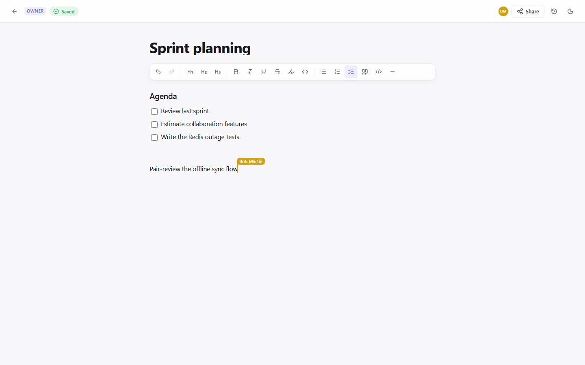
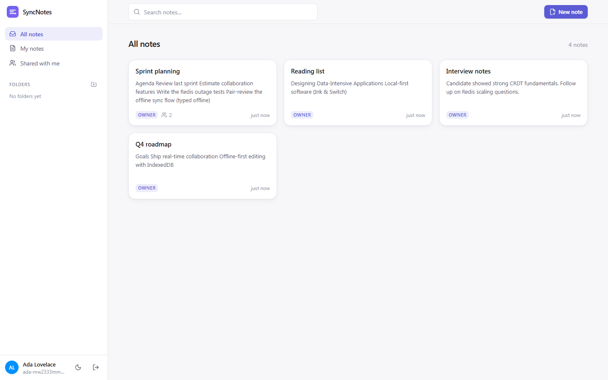
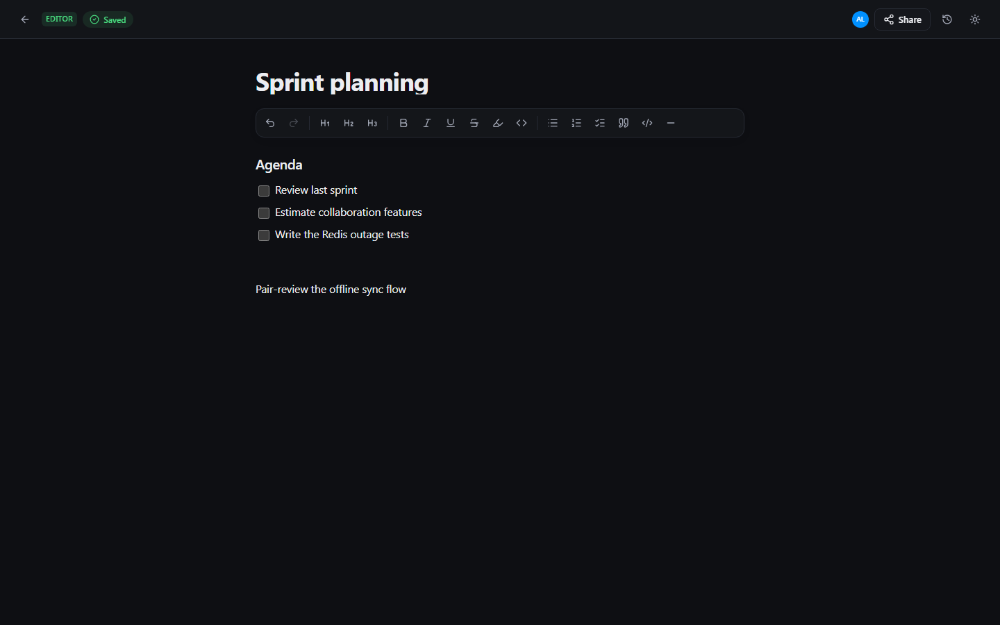
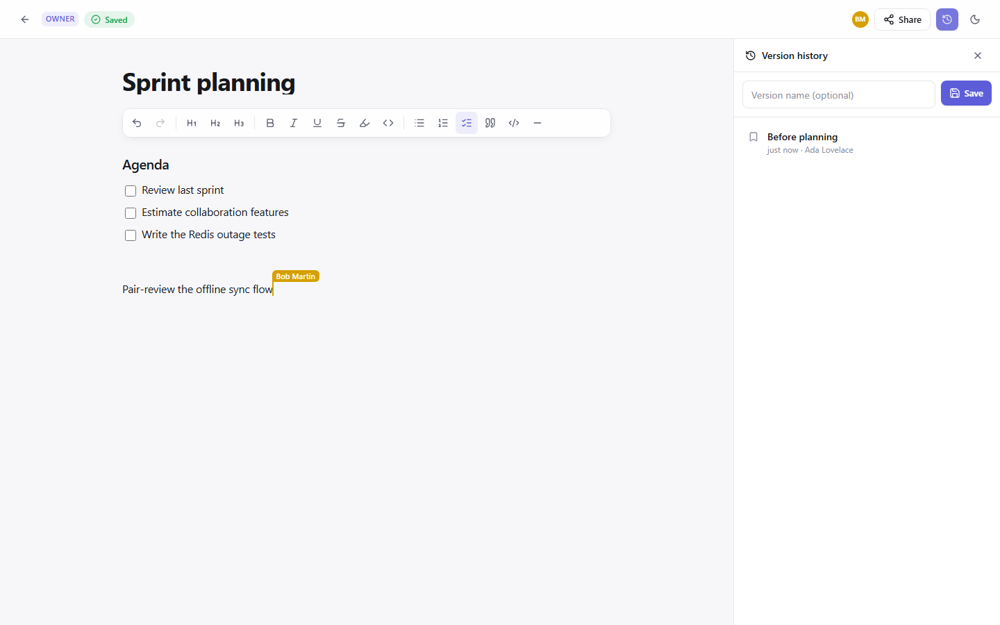
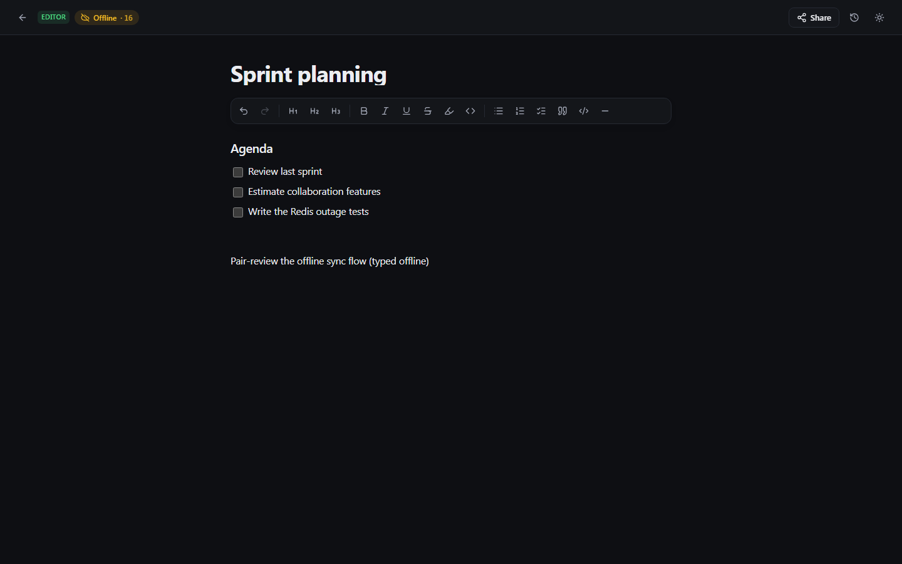
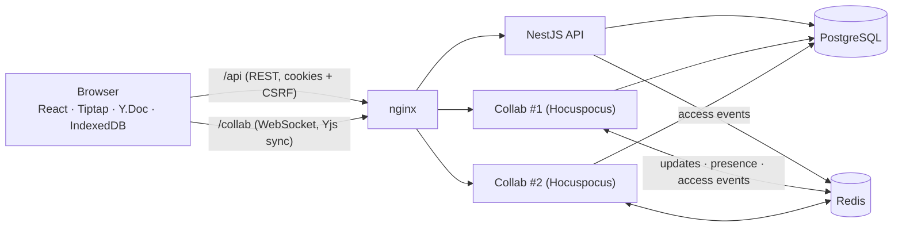

[🇹🇷 Türkçe](README.md) | [🇬🇧 English](README.en.md)

<div align="center">

# SyncNotes

**Real-time collaborative notes — Google-Docs-style co-editing built on a CRDT.**

Several people type into the same note at once, see each other's cursors, keep working
offline and merge cleanly when they reconnect. Permissions are enforced on the server — even on
WebSocket sessions that are already open.

[](https://github.com/melihuur1/syncnotes/actions/workflows/ci.yml)




</div>

---

## Highlights

| Engineering problem | How SyncNotes solves it |
| --- | --- |
| Concurrent edits must never be lost | **Yjs CRDT** for body and title; verified with 3 clients inserting at random positions concurrently |
| Viewers must not be able to edit — not only in the UI | Viewer WebSocket connections are **read-only on the server**; updates from a tampered client are dropped |
| Revoked users must lose access on their *open* session | Redis **push** event closes / downgrades live connections instantly; when the event is lost, a per-message **TTL re-check** and a periodic **permission sweep** bound write *and* read access to 5 s |
| No lost updates across instances | Binary Yjs state persisted with **merge-on-write under a row lock** (`SELECT … FOR UPDATE`) |
| Work offline, merge later | **IndexedDB replica** (y-indexeddb) + Yjs state-vector sync on reconnect |
| Same note open on several backend instances | Hocuspocus **Redis fan-out** for updates and presence; 2 instances behind nginx round-robin |
| Redis outage | Documented **degraded mode**: no edit lost, same-instance editing stays real-time, instances converge through Postgres (anti-entropy also covers asymmetric partitions), one-round resync on recovery — and an honest list of what Redis *is* needed for |
| Data survives restarts | Graceful shutdown flushes pending stores; restart test in the suite |
| Secure sessions | HttpOnly cookies, refresh-token **rotation with reuse detection**, double-submit CSRF, Argon2id, lockout, rate limits |

Read the full design rationale in **[docs/architecture.md](docs/architecture.md)**.

## Features

- Sign up / sign in with secure cookie sessions
- Notes with a collaborative title and rich-text body (headings, lists, checklists, quotes,
  code, highlights) — Markdown shortcuts work
- Personal folders, "My notes" / "Shared with me" views, full-text search
- Share by e-mail as **Editor** or **Viewer**; change roles or remove people live
- Live cursors with names, presence avatars, connection & sync status
- Offline editing with a pending-changes indicator; edits survive closing the tab
- Version history: named and automatic snapshots, preview, one-click restore for everyone
- Responsive dashboard with light / dark theme

<table>
  <tr>
    <td></td>
    <td></td>
  </tr>
  <tr>
    <td></td>
    <td></td>
  </tr>
</table>

## Architecture



- **`apps/api`** — NestJS 11: auth, notes, folders, sharing & roles, version listing, short-lived
  collaboration tickets.
- **`apps/collab`** — Hocuspocus 4: Yjs sync, authorisation per message, persistence, version
  snapshots/restores, Redis scaling with outage handling.
- **`apps/web`** — React 19 + Vite + Tiptap 3 + Yjs.
- **`packages/db`** — Prisma 7 schema, migrations and client shared by both servers.
- **`packages/shared`** — typed contracts (roles, events, messages, DTOs).

## Tech stack

**Frontend** React 19, TypeScript, Vite 8, Tiptap 3, Yjs, y-indexeddb, TanStack Query,
Tailwind CSS 4, Radix UI  
**Backend** NestJS 11, Hocuspocus 4, Prisma 7 (pg adapter), PostgreSQL 17, Redis 7, ioredis, Argon2  
**Quality** Jest + Supertest, Vitest + Testing Library, Playwright, ESLint, Prettier, GitHub Actions  
**Ops** Docker multi-stage builds, Docker Compose, nginx

## Quick start (Docker)

Requires Docker with Compose v2.

```bash
docker compose up --build
```

Open **http://localhost:8080**, create two accounts (e.g. in a normal and a private window),
share a note and type in both.

The stack runs nginx, the API, **two** collaboration instances, a migration job, Postgres and
Redis. Host ports: `8080` (app), `5433` (Postgres), `6380` (Redis).

> The compose file ships development secrets. Set `JWT_ACCESS_SECRET`, `COLLAB_TICKET_SECRET`
> and `COOKIE_SECURE=true` before exposing it anywhere.

## Local development

Requirements: Node.js ≥ 22.12, npm ≥ 10, Docker.

```bash
npm install
cp .env.example .env
npm run infra:up          # Postgres + Redis in Docker
npm run db:migrate        # apply migrations to the dev database
npm run dev               # api :4000, collab :1234, web :5173 (with proxy)
```

Open http://localhost:5173. Vite proxies `/api` and `/collab`, so everything is same-origin like
in production.

## Testing

| Suite | Command | What it covers |
| --- | --- | --- |
| API unit + integration (Jest, Supertest, real Postgres/Redis) | `npm run test:api` | auth hardening, CSRF, refresh rotation & reuse detection, lockout, roles, 404 vs 403, sharing, tickets, events |
| Collaboration server (Vitest, real servers) | `npm run test:collab` | handshake auth, concurrency, viewer enforcement, live revocation & downgrade, TTL fallback, persistence & restart, offline merge, multi-instance, **Redis outage & recovery**, versions |
| Web unit (Vitest, jsdom) | `npm run test:web` | API client (CSRF, single-flight refresh), Y.Text diffing & caret transform, connection state, offline cache cleanup |
| End-to-end (Playwright) | `npm run test:e2e` | two browsers co-editing with live carets, viewer UI, offline merge via `setOffline`, IndexedDB durability, revocation, version restore |

Integration suites use a separate `syncnotes_test` database (created by the Postgres init
script); run `npm run db:migrate:test` once before the first run. E2E tests reuse the dev
servers from `npm run dev` locally; CI starts the production builds.

Current totals: **41** API · **40** collab · **5** shared · **26** web unit · **7** E2E.

## REST API

All routes are prefixed with `/api`. State-changing requests need the `x-csrf-token` header.

| Method | Route | Role | Description |
| --- | --- | --- | --- |
| `GET` | `/auth/csrf` | public | issue CSRF token |
| `POST` | `/auth/register` · `/auth/login` | public | create session (cookies) |
| `POST` | `/auth/refresh` · `/auth/logout` | public | rotate / revoke session |
| `GET` | `/auth/me` | user | current user |
| `GET` `POST` | `/notes` | user | list (`scope`, `folderId`, `q`) / create |
| `GET` | `/notes/:id` | viewer | note with members |
| `PATCH` | `/notes/:id/folder` | viewer | file note in one of *your* folders |
| `DELETE` | `/notes/:id` | owner | delete for everyone |
| `POST` | `/notes/:id/leave` | editor/viewer | leave a shared note |
| `POST` | `/notes/:id/collab-ticket` | viewer | 60-second WebSocket ticket |
| `GET` `POST` | `/notes/:id/members` | viewer / owner | list / invite (`EDITOR`, `VIEWER`) |
| `PATCH` `DELETE` | `/notes/:id/members/:userId` | owner | change role / remove (applied live) |
| `GET` | `/notes/:id/versions[/:versionId]` | viewer | list / fetch snapshot |
| `GET` `POST` `PATCH` `DELETE` | `/folders[/:id]` | user | personal folders |
| `GET` | `/health` | public | Postgres / Redis status |

Collaboration commands (`version.create`, `version.restore`) and server notifications
(`access.changed`, `access.revoked`, `note.deleted`, `versions.changed`, `version.restored`)
are Hocuspocus stateless messages; see `packages/shared/src/collab.ts`.

## Configuration

See [`.env.example`](.env.example). Most relevant:

| Variable | Default | Purpose |
| --- | --- | --- |
| `JWT_ACCESS_SECRET` / `COLLAB_TICKET_SECRET` | — | must differ, ≥ 32 chars (validated at boot) |
| `JWT_ACCESS_TTL_SECONDS` | `900` | access-token lifetime |
| `COLLAB_TICKET_TTL_SECONDS` | `60` | WebSocket ticket lifetime (max 300) |
| `PERMISSION_CACHE_TTL_MS` | `5000` | max time a revoked user can still *write* when Redis events are lost |
| `PERMISSION_SWEEP_INTERVAL_MS` | `5000` | max time a revoked user can still *read* when Redis events are lost |
| `ANTI_ENTROPY_INTERVAL_MS` | `15000` | Postgres reconciliation while healthy (asymmetric partitions) |
| `STORE_DEBOUNCE_MS` / `STORE_MAX_DEBOUNCE_MS` | `2000` / `10000` | persistence debounce |
| `AUTO_VERSION_INTERVAL_MINUTES` | `10` | automatic snapshot interval |
| `THROTTLE_AUTH_LIMIT` | `10` | credential requests per IP per minute |

## Project structure

```
apps/
  api/        NestJS REST API          (src/auth, notes, folders, common/guards …; test/*.int-spec.ts)
  collab/     Hocuspocus server        (src/extensions/*; test/* incl. tcp-proxy for outages)
  web/        React SPA                (src/collab, editor, pages, components; e2e/*.spec.ts)
packages/
  db/         Prisma schema, migrations, client factory
  shared/     roles, access events, stateless messages, DTO types
infra/        nginx config, Postgres init (test database)
docs/         architecture.md, screenshots
```

## Known limitations

- Invitations require an existing account (no pending e-mail invites yet).
- Offline *cold start* (opening the app with no network) needs a service worker — edits made
  offline survive a tab close and sync later, but the app shell itself is not cached.
- API rate-limit counters are per process (move to Redis storage for multiple API replicas).

More in [docs/architecture.md § Trade-offs](docs/architecture.md#12-trade-offs-and-future-work).

## License

[MIT](LICENSE) © 2026 Melih Uğur
