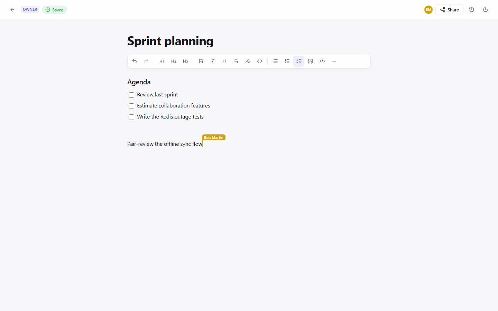
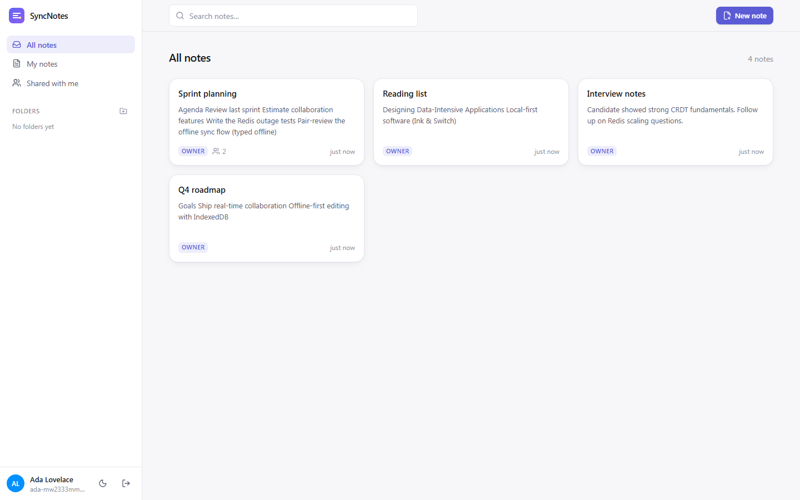
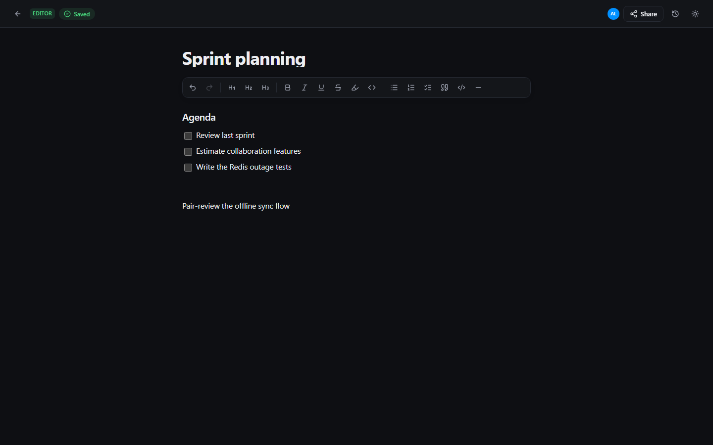
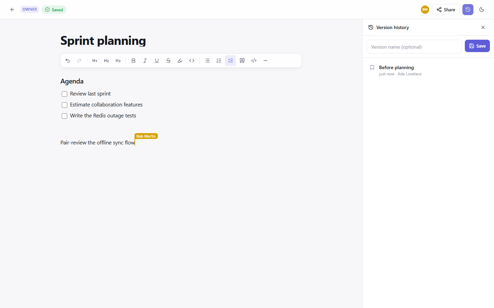
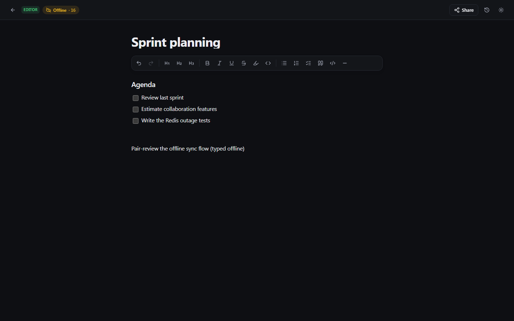
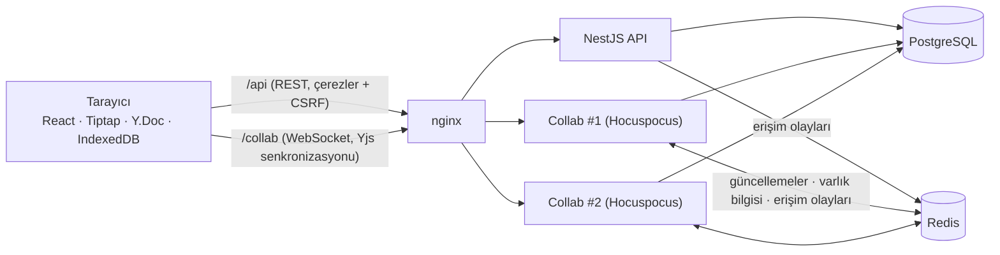

[🇹🇷 Türkçe](README.md) | [🇬🇧 English](README.en.md)

<div align="center">

# SyncNotes

**Gerçek zamanlı ortak not uygulaması — CRDT üzerine kurulu, Google Docs tarzı eşzamanlı düzenleme.**

Birden fazla kişi aynı nota aynı anda yazar, birbirinin imlecini görür, çevrimdışıyken çalışmaya
devam eder ve bağlantı geri geldiğinde değişiklikler sorunsuzca birleşir. Yetkiler sunucuda
uygulanır — zaten açık olan WebSocket oturumlarında bile.

[](https://github.com/melihuur1/syncnotes/actions/workflows/ci.yml)




</div>

---

## Öne çıkanlar

| Mühendislik problemi | SyncNotes'un çözümü |
| --- | --- |
| Eşzamanlı düzenlemeler asla kaybolmamalı | Gövde ve başlık için **Yjs CRDT**; rastgele konumlara eşzamanlı ekleme yapan 3 istemciyle doğrulandı |
| İzleyiciler düzenleme yapamamalı — yalnızca arayüzde değil | İzleyici WebSocket bağlantıları **sunucu tarafında salt okunurdur**; kurcalanmış bir istemciden gelen güncellemeler atılır |
| Yetkisi kaldırılan kullanıcılar *açık* oturumlarında da erişimi kaybetmeli | Redis üzerinden gelen **push** olayı canlı bağlantıları anında kapatır ya da yetkilerini düşürür; olay kaybolursa mesaj başına **TTL yeniden denetimi** ve periyodik **yetki taraması** (permission sweep) yazma *ve* okuma erişimini 5 sn ile sınırlar |
| Sunucu örnekleri arasında güncelleme kaybı olmamalı | İkili (binary) Yjs durumu, **satır kilidi altında yazarken birleştirme** (merge-on-write, `SELECT … FOR UPDATE`) ile kalıcı hale getirilir |
| Çevrimdışı çalış, sonra birleştir | **IndexedDB replikası** (y-indexeddb) + yeniden bağlanınca Yjs durum vektörü (state vector) senkronizasyonu |
| Aynı not birden fazla backend örneğinde açık | Güncellemeler ve varlık bilgisi (presence) için Hocuspocus **Redis fan-out**'u; nginx round-robin arkasında 2 sunucu örneği |
| Redis kesintisi | Belgelenmiş **kısıtlı çalışma modu** (degraded mode): hiçbir düzenleme kaybolmaz, aynı örnek üzerindeki düzenleme gerçek zamanlı kalır, örnekler Postgres üzerinden yakınsar (anti-entropy asimetrik ağ bölünmelerini de kapsar), toparlanmada tek turda yeniden senkronizasyon — ve Redis'in gerçekte *neler için* gerekli olduğuna dair dürüst bir liste |
| Veriler yeniden başlatmalarda korunur | Kontrollü kapanış (graceful shutdown) bekleyen kayıt işlemlerini tamamlar; test paketinde yeniden başlatma testi bulunur |
| Güvenli oturumlar | HttpOnly çerezler, **yeniden kullanım tespitli** refresh token **rotasyonu**, double-submit CSRF, Argon2id, hesap kilitleme, istek hızı sınırları |

Tasarım kararlarının tüm gerekçeleri için **[docs/architecture.md](docs/architecture.md)** (İngilizce)
belgesine bakın.

## Özellikler

- Güvenli çerez oturumlarıyla kayıt olma / giriş yapma
- Ortak düzenlenen başlık ve zengin metin gövdesine sahip notlar (başlıklar, listeler, yapılacaklar
  listeleri, alıntılar, kod, vurgulamalar) — Markdown kısayolları çalışır
- Kişisel klasörler, "My notes" (Notlarım) / "Shared with me" (Benimle paylaşılanlar) görünümleri,
  tam metin arama
- E-posta ile **Editor** (düzenleyici) veya **Viewer** (izleyici) olarak paylaşma; rolleri canlı
  olarak değiştirme veya kişileri nottan çıkarma
- İsim etiketli canlı imleçler, varlık (presence) avatarları, bağlantı ve senkronizasyon durumu
- Bekleyen değişiklik göstergesiyle çevrimdışı düzenleme; düzenlemeler sekme kapatılsa bile korunur
- Sürüm geçmişi: adlandırılmış ve otomatik anlık görüntüler (snapshot), önizleme, herkes için tek
  tıkla geri yükleme
- Açık / koyu temalı, duyarlı (responsive) kontrol paneli

<table>
  <tr>
    <td></td>
    <td></td>
  </tr>
  <tr>
    <td></td>
    <td></td>
  </tr>
</table>

## Mimari



- **`apps/api`** — NestJS 11: kimlik doğrulama, notlar, klasörler, paylaşım ve roller, sürüm
  listeleme, kısa ömürlü ortak çalışma biletleri (collaboration ticket).
- **`apps/collab`** — Hocuspocus 4: Yjs senkronizasyonu, mesaj başına yetkilendirme, kalıcılık,
  sürüm anlık görüntüleri/geri yüklemeleri, kesinti yönetimli Redis ölçekleme.
- **`apps/web`** — React 19 + Vite + Tiptap 3 + Yjs.
- **`packages/db`** — iki sunucunun ortak kullandığı Prisma 7 şeması, migration'lar ve istemci.
- **`packages/shared`** — tipli sözleşmeler (roller, olaylar, mesajlar, DTO'lar).

## Teknoloji yığını

**Frontend** React 19, TypeScript, Vite 8, Tiptap 3, Yjs, y-indexeddb, TanStack Query,
Tailwind CSS 4, Radix UI  
**Backend** NestJS 11, Hocuspocus 4, Prisma 7 (pg adapter), PostgreSQL 17, Redis 7, ioredis, Argon2  
**Kalite** Jest + Supertest, Vitest + Testing Library, Playwright, ESLint, Prettier, GitHub Actions  
**Operasyon** Docker çok aşamalı (multi-stage) derlemeler, Docker Compose, nginx

## Hızlı başlangıç (Docker)

Compose v2 destekli Docker gerektirir.

```bash
docker compose up --build
```

**http://localhost:8080** adresini açın, iki hesap oluşturun (örneğin biri normal, diğeri gizli
pencerede), bir notu paylaşın ve iki pencerede birden yazın.

Yığın; nginx, API, **iki** ortak çalışma sunucusu örneği, bir migration işi, Postgres ve Redis'ten
oluşur. Ana makine portları: `8080` (uygulama), `5433` (Postgres), `6380` (Redis).

> Compose dosyası geliştirme amaçlı gizli anahtarlarla gelir. Yığını herhangi bir yerde dışarıya
> açmadan önce `JWT_ACCESS_SECRET` ve `COLLAB_TICKET_SECRET` değerlerini ayarlayın ve
> `COOKIE_SECURE=true` yapın.

## Yerel geliştirme

Gereksinimler: Node.js ≥ 22.12, npm ≥ 10, Docker.

```bash
npm install
cp .env.example .env
npm run infra:up          # Docker'da Postgres + Redis
npm run db:migrate        # migration'ları geliştirme veritabanına uygula
npm run dev               # api :4000, collab :1234, web :5173 (proxy ile)
```

http://localhost:5173 adresini açın. Vite, `/api` ve `/collab` isteklerini proxy üzerinden
yönlendirir; böylece her şey üretimdeki gibi aynı kaynaktan (same-origin) sunulur.

## Testler

| Test paketi | Komut | Neleri kapsar |
| --- | --- | --- |
| API birim + entegrasyon (Jest, Supertest, gerçek Postgres/Redis) | `npm run test:api` | kimlik doğrulama sıkılaştırması, CSRF, refresh rotasyonu ve yeniden kullanım tespiti, hesap kilitleme, roller, 404 ve 403 ayrımı, paylaşım, biletler, olaylar |
| Ortak çalışma sunucusu (Vitest, gerçek sunucular) | `npm run test:collab` | el sıkışma (handshake) kimlik doğrulaması, eşzamanlılık, izleyici kısıtlamasının uygulanması, canlı yetki kaldırma ve rol düşürme, TTL ile yedek denetim, kalıcılık ve yeniden başlatma, çevrimdışı birleştirme, çoklu sunucu örneği, **Redis kesintisi ve toparlanma**, sürümler |
| Web birim (Vitest, jsdom) | `npm run test:web` | API istemcisi (CSRF, eşzamanlı 401'lerde tek refresh — single-flight), Y.Text fark hesaplama ve imleç konumu dönüşümü, bağlantı durumu, çevrimdışı önbellek temizliği |
| Uçtan uca (Playwright) | `npm run test:e2e` | canlı imleçlerle ortak düzenleme yapan iki tarayıcı, izleyici arayüzü, `setOffline` ile çevrimdışı birleştirme, IndexedDB kalıcılığı, yetki kaldırma, sürüm geri yükleme |

Entegrasyon paketleri ayrı bir `syncnotes_test` veritabanı kullanır (Postgres başlangıç betiği
tarafından oluşturulur); ilk çalıştırmadan önce bir kez `npm run db:migrate:test` çalıştırın. Uçtan
uca testler yerelde `npm run dev` ile başlatılan geliştirme sunucularını yeniden kullanır; CI ise
üretim derlemelerini başlatır.

Güncel toplamlar: **41** API · **40** collab · **5** shared · **26** web birim · **7** E2E.

## REST API

Tüm rotalar `/api` önekiyle başlar. Durum değiştiren istekler `x-csrf-token` başlığını gerektirir.

| Metot | Rota | Rol | Açıklama |
| --- | --- | --- | --- |
| `GET` | `/auth/csrf` | herkese açık | CSRF token'ı verir |
| `POST` | `/auth/register` · `/auth/login` | herkese açık | oturum oluşturur (çerezler) |
| `POST` | `/auth/refresh` · `/auth/logout` | herkese açık | oturumu yeniler (rotasyon) / iptal eder |
| `GET` | `/auth/me` | kullanıcı | mevcut kullanıcı |
| `GET` `POST` | `/notes` | kullanıcı | listele (`scope`, `folderId`, `q`) / oluştur |
| `GET` | `/notes/:id` | izleyici | üyeleriyle birlikte not |
| `PATCH` | `/notes/:id/folder` | izleyici | notu *kendi* klasörlerinizden birine yerleştirir |
| `DELETE` | `/notes/:id` | sahip | herkes için siler |
| `POST` | `/notes/:id/leave` | düzenleyici/izleyici | paylaşılan nottan ayrılır |
| `POST` | `/notes/:id/collab-ticket` | izleyici | 60 saniyelik WebSocket bileti |
| `GET` `POST` | `/notes/:id/members` | izleyici / sahip | listele / davet et (`EDITOR`, `VIEWER`) |
| `PATCH` `DELETE` | `/notes/:id/members/:userId` | sahip | rol değiştir / çıkar (canlı uygulanır) |
| `GET` | `/notes/:id/versions[/:versionId]` | izleyici | listele / anlık görüntüyü getir |
| `GET` `POST` `PATCH` `DELETE` | `/folders[/:id]` | kullanıcı | kişisel klasörler |
| `GET` | `/health` | herkese açık | Postgres / Redis durumu |

Ortak çalışma komutları (`version.create`, `version.restore`) ve sunucu bildirimleri
(`access.changed`, `access.revoked`, `note.deleted`, `versions.changed`, `version.restored`)
Hocuspocus durumsuz (stateless) mesajlarıdır; bkz. `packages/shared/src/collab.ts`.

## Yapılandırma

Bkz. [`.env.example`](.env.example). En önemlileri:

| Değişken | Varsayılan | Amaç |
| --- | --- | --- |
| `JWT_ACCESS_SECRET` / `COLLAB_TICKET_SECRET` | — | birbirinden farklı ve en az 32 karakter olmalı (açılışta doğrulanır) |
| `JWT_ACCESS_TTL_SECONDS` | `900` | access token ömrü |
| `COLLAB_TICKET_TTL_SECONDS` | `60` | WebSocket bileti ömrü (en fazla 300) |
| `PERMISSION_CACHE_TTL_MS` | `5000` | Redis olayları kaybolduğunda yetkisi kaldırılmış bir kullanıcının hâlâ *yazabileceği* en uzun süre |
| `PERMISSION_SWEEP_INTERVAL_MS` | `5000` | Redis olayları kaybolduğunda yetkisi kaldırılmış bir kullanıcının hâlâ *okuyabileceği* en uzun süre |
| `ANTI_ENTROPY_INTERVAL_MS` | `15000` | sistem sağlıklıyken Postgres üzerinden uzlaştırma (asimetrik ağ bölünmeleri) |
| `STORE_DEBOUNCE_MS` / `STORE_MAX_DEBOUNCE_MS` | `2000` / `10000` | kalıcı kayıt için debounce (erteleme) süreleri |
| `AUTO_VERSION_INTERVAL_MINUTES` | `10` | otomatik anlık görüntü aralığı |
| `THROTTLE_AUTH_LIMIT` | `10` | IP başına dakikada izin verilen kimlik bilgisi isteği |

## Proje yapısı

```
apps/
  api/        NestJS REST API          (src/auth, notes, folders, common/guards …; test/*.int-spec.ts)
  collab/     Hocuspocus sunucusu      (src/extensions/*; test/* — kesintiler için tcp-proxy dahil)
  web/        React SPA                (src/collab, editor, pages, components; e2e/*.spec.ts)
packages/
  db/         Prisma şeması, migration'lar, istemci fabrikası
  shared/     roller, erişim olayları, durumsuz mesajlar, DTO tipleri
infra/        nginx yapılandırması, Postgres başlangıç betiği (test veritabanı)
docs/         architecture.md, ekran görüntüleri
```

## Bilinen sınırlamalar

- Davetler mevcut bir hesap gerektirir (bekleyen e-posta davetleri henüz desteklenmiyor).
- Çevrimdışı *soğuk başlatma* (uygulamayı ağ bağlantısı olmadan açmak) bir service worker gerektirir
  — çevrimdışı yapılan düzenlemeler sekme kapatılsa da korunur ve sonradan senkronize edilir, ancak
  uygulama kabuğunun (app shell) kendisi önbelleğe alınmaz.
- API hız sınırı sayaçları süreç başına tutulur (birden fazla API replikası için Redis depolamasına
  taşınmalıdır).

Daha fazlası: [docs/architecture.md § Trade-offs](docs/architecture.md#12-trade-offs-and-future-work)
(İngilizce).

## Lisans

[MIT](LICENSE) © 2026 Melih Uğur
