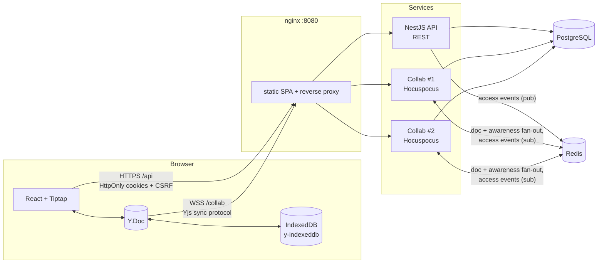
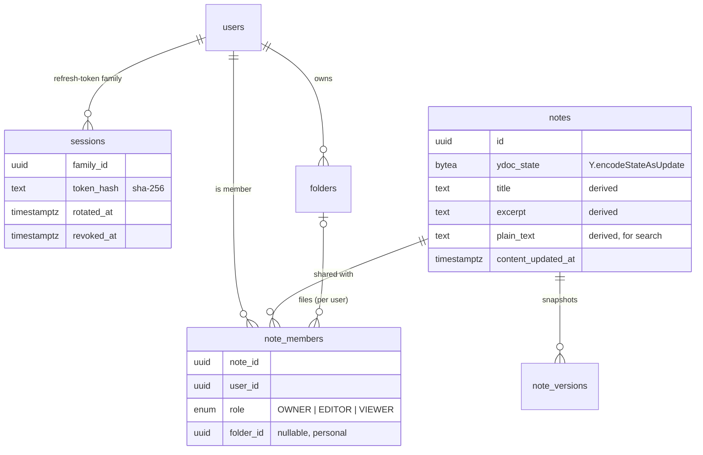
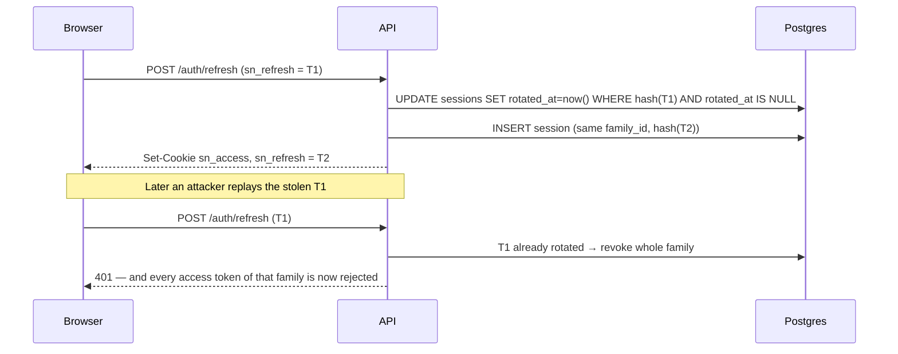
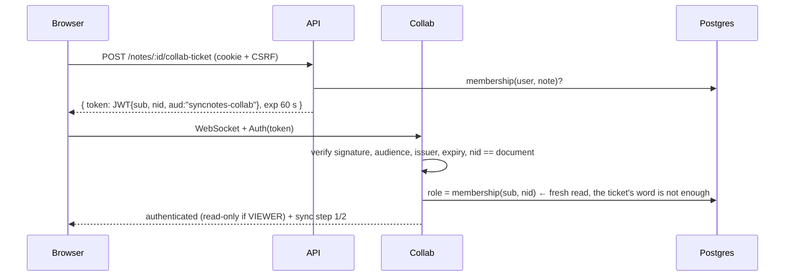
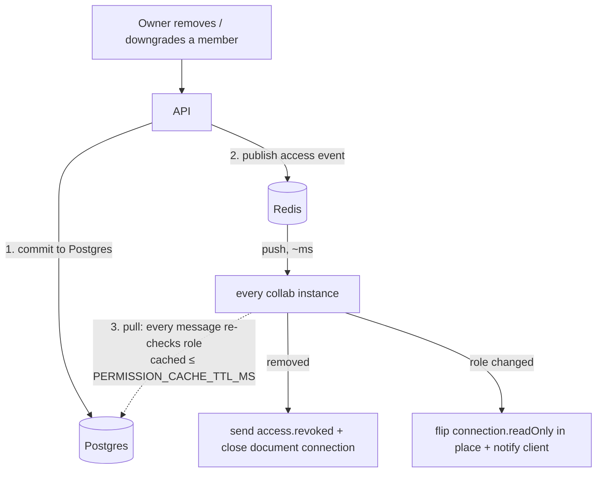
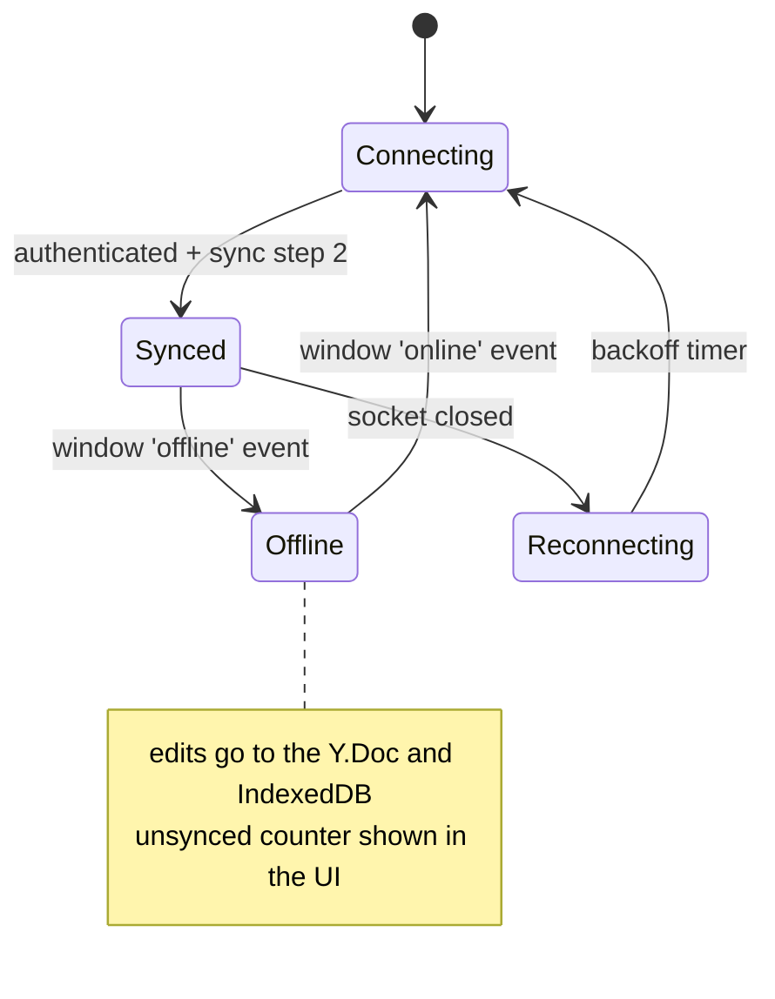

# SyncNotes — Architecture

This document explains how SyncNotes works and, more importantly, **why** it is built this way.
Every guarantee described here is backed by an automated test; the
[test map](#11-what-the-tests-prove) at the end links each claim to the suite that verifies it.

- [1. Goals and non-goals](#1-goals-and-non-goals)
- [2. System overview](#2-system-overview)
- [3. Data model](#3-data-model)
- [4. Authentication and sessions](#4-authentication-and-sessions)
- [5. The collaboration protocol](#5-the-collaboration-protocol)
- [6. Authorisation on a live WebSocket](#6-authorisation-on-a-live-websocket)
- [7. Persistence](#7-persistence)
- [8. Offline editing and reconnection](#8-offline-editing-and-reconnection)
- [9. Horizontal scaling and Redis failure](#9-horizontal-scaling-and-redis-failure)
- [10. Version history](#10-version-history)
- [11. What the tests prove](#11-what-the-tests-prove)
- [12. Trade-offs and future work](#12-trade-offs-and-future-work)

---

## 1. Goals and non-goals

**Goals**

1. Several people edit the same note at the same time and **no keystroke is ever lost**.
2. Permissions are enforced by the **server**, including on WebSocket sessions that are
   already open when access changes.
3. Users can keep working **offline**; changes merge when the connection returns.
4. The collaboration tier scales **horizontally** and degrades gracefully when Redis fails.
5. Data survives restarts and deploys.

**Non-goals (for now)**: comments, real-time cursors outside the editor body, end-to-end
encryption, multi-region deployment. See [§12](#12-trade-offs-and-future-work).

## 2. System overview



| Component | Responsibility | Does **not** |
| --- | --- | --- |
| **web** (`apps/web`) | UI, Tiptap editor, Yjs replica, offline cache, connection state | trust itself for permissions |
| **api** (`apps/api`) | accounts, sessions, notes/folders, sharing & roles, version listing, issuing collaboration tickets | touch live documents |
| **collab** (`apps/collab`) | Yjs sync over WebSocket, presence, per-message authorisation, persistence, snapshots/restores | manage accounts or memberships |
| **PostgreSQL** | source of truth: users, sessions, memberships, binary Yjs state, versions | — |
| **Redis** | low-latency fan-out between collab instances; API → collab access events | hold anything that cannot be lost |

Two backend processes with a narrow contract (`packages/shared`) keep responsibilities clear:
the API never edits documents, the collaboration server never decides *who* may do *what* —
it only enforces what Postgres says.

Socket.IO is not used: Yjs already defines an efficient sync protocol (state vectors + binary
diffs) and Hocuspocus implements it, so a second real-time channel would add a protocol
without solving a new problem. Commands that are not document edits (save/restore a version,
role-changed notifications) travel as Hocuspocus *stateless* messages on the same connection.

## 3. Data model



Design decisions:

- **The CRDT is the content.** `notes.ydoc_state` is the binary output of
  `Y.encodeStateAsUpdate`. `title`, `excerpt` and `plain_text` are *projections* written by the
  collaboration server on every store so the REST API can list and search notes without
  decoding CRDTs.
- **Exactly one owner** per note is enforced by the database, not only by code:
  `CREATE UNIQUE INDEX … ON note_members(note_id) WHERE role = 'OWNER'`.
- **Folders are personal.** The folder reference lives on the membership row, so a shared
  note can be in *"Work"* for the owner and *"From Ada"* for a collaborator.
- **Non-members get 404, not 403**, so note ids cannot be probed for existence.

## 4. Authentication and sessions

| Cookie | Content | Flags | Sent to |
| --- | --- | --- | --- |
| `sn_access` | JWT (HS256, 15 min) with `sub`, `sid` (session family) | `HttpOnly; SameSite=Lax` (+`Secure` in prod) | `/` |
| `sn_refresh` | 256-bit random token (stored as SHA-256 hash) | `HttpOnly; SameSite=Strict` | `/api/auth` only |
| `sn_csrf` | random token, readable by JS | `SameSite=Lax` | `/` |

- **Passwords**: Argon2id (19 MiB, t=2). Unknown e-mails run a dummy verification so response
  time does not reveal whether an account exists; both cases return the same message.
- **Brute force**: per-IP rate limit on credential endpoints + per-account lockout
  (5 failures → 15 minutes).
- **CSRF**: double-submit cookie on every state-changing request, plus SameSite cookies and a
  strict CORS allow-list.
- **Refresh rotation with reuse detection** — every refresh token is single-use:



The access-token guard checks that the token's session family is still active, so logout and
reuse detection take effect **immediately** rather than when the 15-minute JWT expires. A
10-second grace window treats a rotated token presented by a second tab as a benign race
instead of theft.

## 5. The collaboration protocol

### Document layout

Each note is one `Y.Doc` (Hocuspocus document name = note id) with two shared types:

| Field | Type | Bound to |
| --- | --- | --- |
| `default` | `Y.XmlFragment` | Tiptap/ProseMirror editor body (via `@tiptap/extension-collaboration`) |
| `title` | `Y.Text` | the title `<input>` (minimal diffs, caret transformed through remote deltas) |

Using a CRDT (instead of OT or last-write-wins) is what makes requirement 1 hold: concurrent
inserts at the same position are ordered deterministically on every replica and nothing is
discarded. The collab suite inserts 120 characters concurrently from three clients at random
positions and asserts every replica, the server and the persisted state contain all of them.

### Handshake: collaboration tickets



Why a ticket instead of sending the access cookie to the WebSocket server?

- the access token stays `HttpOnly` — JavaScript never sees it;
- a ticket is bound to one note and signed with a **different secret and audience**, so a
  leaked ticket is useless against the REST API or another document;
- the provider calls the ticket function on **every reconnect**, so a session that outlives
  the 60-second ticket simply fetches a new one (and loses access the moment the API refuses).

## 6. Authorisation on a live WebSocket

Checking permissions only at connect time is not enough: the hard case is a user whose access
changes **while their socket is open**. SyncNotes layers three mechanisms:



1. **Handshake** — the role is read from Postgres; viewers get a read-only connection.
   Hocuspocus drops sync updates from read-only connections *on the server*, so a modified
   client that ignores the disabled editor still cannot change the document.
2. **Push** — membership changes are published on Redis; every instance applies them to its
   open connections immediately (close on removal, toggle `readOnly` on role change).
3. **Pull** — `beforeHandleMessage` re-checks the role on every inbound message through a
   cache with a short TTL (default 5 s). If the Redis event is lost (Redis down, network
   blip), revocation still takes effect within the TTL. If Postgres is briefly unreachable the
   last known role is used; if nothing is known the server fails closed.

**A subtle CRDT consequence.** Yjs requires causal delivery. When the server drops an update
from a client that became read-only, that client's clock now has a gap; everything it sends
afterwards depends on the dropped update and is *held back* by every other replica forever.
The server stays correct (the test suite verifies this), but the client would silently stop
syncing. The web client therefore **discards its local replica (memory + IndexedDB) and
resyncs from the server whenever its write permission changes.**

## 7. Persistence

- Hocuspocus calls `onStoreDocument` debounced (2 s, at most every 10 s) and on unload.
- **Merge-on-write under a row lock**:

  ```sql
  BEGIN;
  SELECT ydoc_state FROM notes WHERE id = $1 FOR UPDATE;
  -- Y.applyUpdate(liveDoc, persistedState)   ← pull in anything another instance stored
  -- state = Y.encodeStateAsUpdate(liveDoc)    ← union of both
  UPDATE notes SET ydoc_state = state, title = …, excerpt = …, plain_text = … WHERE id = $1;
  COMMIT;
  ```

  Yjs merges are commutative and idempotent, so concurrent stores from different instances can
  never overwrite each other (classic lost-update), and anything merged in is broadcast to that
  instance's clients. This is also why the Redis extension's distributed lock is disabled:
  the official extension *aborts persistence* when it cannot acquire its Redlock, which would
  mean "Redis down ⇒ edits not saved".
- Graceful shutdown flushes pending stores before the process exits, so deploys and restarts
  do not lose the last seconds of typing.

## 8. Offline editing and reconnection



- Every editor keeps a **local replica in IndexedDB** (`y-indexeddb`), namespaced by
  `userId:noteId`, so edits survive closing the tab while offline. Viewers do not keep one.
- The client listens to the browser's `online`/`offline` events and disconnects/reconnects the
  provider immediately instead of waiting for a dead TCP connection to time out.
- On reconnect the Yjs sync protocol exchanges state vectors and each side sends exactly the
  updates the other is missing — offline edits and concurrent online edits merge without
  conflicts.
- Logging out deletes all cached replicas of that user from the device; revocation and
  deletion delete the affected note's replica.

## 9. Horizontal scaling and Redis failure

The Docker deployment runs two collaboration instances behind nginx round-robin, so two
people editing the same note are usually connected to *different* processes. The Hocuspocus
Redis extension relays document updates and presence between instances.

What happens when Redis goes down — every row is covered by `apps/collab/test/scaling.test.ts`,
which places a TCP proxy between the instances and Redis and cuts it:

| Concern | Behaviour while Redis is unavailable |
| --- | --- |
| Users on the **same** instance | Unaffected — real-time collaboration continues. |
| Users on **different** instances | Converge through Postgres: merge-on-write stores + a degraded-mode reconciler that pulls newer persisted state every 3 s. Latency ≈ store debounce + reconcile interval. |
| Persistence | Unaffected (Postgres row lock, no Redis lock). |
| Opening a document | Works; the Redis subscription is deferred. |
| Access revocation | Enforced within `PERMISSION_CACHE_TTL_MS` by the per-message re-check. |
| Health | `/health` reports `"redis": "degraded"`. |
| **Recovery** | Each instance re-announces its state vector for every open document; peers answer with exactly what is missing — one resync round, no unbounded queues. Real-time fan-out resumes (< 1 s in tests). |

The extension is wrapped (`ResilientRedisExtension`) rather than forked: it disables the lock,
skips publishes while disconnected (instead of queuing them unboundedly) and never lets a
document load block on Redis — using only the extension's public hooks.

## 10. Version history

- **Snapshots** are history-free content copies (`Y.Doc` with cloned body + title) stored as
  binary updates. Created manually (named) or automatically at most every 10 minutes during
  editing (auto snapshots are pruned to the latest 50).
- Snapshots are created and restored by the **collaboration server**, the only place where the
  live document exists, via stateless messages on the authenticated connection (editor role
  re-checked without cache).
- **Restore is a forward edit**, not a state overwrite: the server deletes the current content
  and inserts a copy of the snapshot inside one transaction. Overwriting the stored state would
  be undone the moment any client with the newer state reconnects; a forward edit propagates to
  online *and* offline replicas like any other change. The pre-restore content is saved first
  (`RESTORE` snapshot), so a restore can itself be undone.
- Previews are rendered client-side from the binary snapshot with the same editor schema, so
  what you preview is exactly what you restore.

## 11. What the tests prove

| Requirement | Verified by |
| --- | --- |
| Concurrent edits never lose updates | `collab/test/collaboration.test.ts` — 3 clients × 40 random-position inserts; replicas, server and DB identical |
| Viewer cannot modify, enforced server-side | `collab/test/collaboration.test.ts` (raw provider sends updates anyway) + `web/e2e` (UI read-only) |
| Revoked user's open session stops editing | `collab/test/revocation.test.ts` (push), TTL fallback without event, `web/e2e` revocation |
| Live downgrade / upgrade without reconnect | `collab/test/revocation.test.ts` |
| Clock-gap safety after rejected updates | `collab/test/revocation.test.ts` |
| Binary persistence, derived columns | `collab/test/persistence.test.ts` |
| Data survives a server restart | `collab/test/persistence.test.ts` |
| No lost updates across instances (merge-on-write) | `collab/test/persistence.test.ts`, `collab/test/scaling.test.ts` |
| Offline edits merge on reconnect | `collab/test/persistence.test.ts`, `web/e2e` (`setOffline`) |
| Offline edits survive closing the tab | `web/e2e` (IndexedDB) |
| Multi-instance sync of content and presence | `collab/test/scaling.test.ts` |
| Redis outage behaviour + recovery | `collab/test/scaling.test.ts` (TCP proxy cut/restore) |
| Ticket validation (signature, expiry, audience, document, membership) | `collab/test/auth.test.ts`, `api/test/sharing.int-spec.ts` |
| Auth hardening (cookies, CSRF, lockout, rotation, reuse detection, logout) | `api/test/auth.int-spec.ts`, unit specs |
| Role hierarchy and 404/403 semantics on REST | `api/test/notes.int-spec.ts`, `api/test/sharing.int-spec.ts` |
| Version snapshot / restore / permissions | `collab/test/versions.test.ts`, `web/e2e` |

## 12. Trade-offs and future work

- **Auth DB lookup per request.** Checking the session family on every request makes logout
  instant at the cost of one indexed query; a Redis-backed revocation list would remove it.
- **Rate limiting is per process.** `@nestjs/throttler` uses in-memory storage; with several
  API replicas it should move to Redis storage.
- **Full-state writes.** Each store writes the whole document state. For very large documents
  an append-only update log with periodic compaction would reduce write volume.
- **Restore semantics.** Edits an offline user made to content that was later replaced by a
  restore are superseded (the pre-restore snapshot keeps them recoverable).
- **Offline cold start.** Edits continue while the app is open and survive a tab close, but
  opening the app from scratch without a network needs a service worker (PWA) — not built yet.
- **Invitations** currently require an existing account; pending e-mail invitations would need
  an outbox + mailer.
